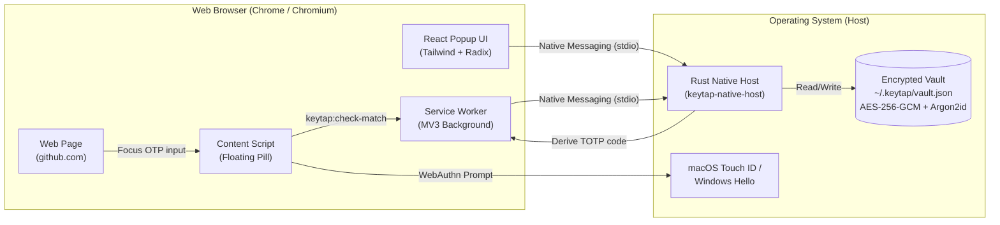

<div align="center">

# 🔑 Keytap

**Local-first, biometric 2FA / TOTP autofill browser extension powered by Rust and WebAuthn.**

[](https://www.rust-lang.org/)
[](https://www.typescriptlang.org/)
[](https://react.dev/)
[](https://developer.chrome.com/docs/extensions/mv3/intro/)
[](https://tailwindcss.com/)
[](https://webauthn.io/)
[](SECURITY.md)
[](LICENSE)

<br />

Keytap bridges the gap between desktop password managers and browser convenience: **your 2FA secrets never leave your device or enter the browser renderer**, yet you get instant one-tap Touch ID / system passcode autofill right in your browser.

</div>

---

## ⚡ Highlights

- **🔒 Local-First Security Architecture**: Shared secrets (TOTP keys) live in an encrypted on-disk vault managed by a lightweight Rust native host. Only short-lived 6-digit codes cross into the browser over Chrome's secure stdio Native Messaging pipe.
- **👆 Biometric Autofill (Touch ID / Passkey)**: Unlock your vault and autofill codes with Apple Touch ID or Windows Hello.
- **🚀 In-Page Floating Pill & Auto-Submit**: Automatically detects 2FA/OTP inputs, presents an inline `⚡ Autofill with Touch ID` pill, fills the code, and presses Enter or clicks Submit for you.
- **🌐 Strict Origin Authorization**: Prevents phishing by strictly enforcing domain boundaries. An account authorized for `https://github.com` will never be filled on malicious lookalike domains (e.g. `github.com.evil.com`).
- **📥 Effortless Import**: Add accounts via `otpauth://` setup links, QR code image uploads, or import entire batches exported from Google Authenticator.
- **🛡️ Zero Cloud Dependency**: 100% offline, self-contained, and open source. No servers, no subscriptions, no telemetry.

---

## 🏗️ Architecture Overview



---

## 📋 Prerequisites

Before installing, ensure you have the following toolchains installed:

### 1. Rust (Cargo 1.70+)
Required to compile the native host binary and core cryptography:
- **macOS / Linux**:
  ```bash
  curl --proto '=https' --tlsv1.2 -sSf https://sh.rustup.rs | sh -s -- -y
  source "$HOME/.cargo/env"
  ```
- **Windows**:
  Download and run [rustup-init.exe](https://rustup.rs/).

### 2. Node.js & npm (or Bun)
Required to build the extension frontend:
- **Node.js**: v18 or higher ([nodejs.org](https://nodejs.org/))
- **Bun** *(optional)*: `curl -fsSL https://bun.sh/install | bash`

### 3. Chromium-Based Browser
- Google Chrome, Brave, Arc, or Microsoft Edge.

---

## 🍏 Setup & Installation — macOS

### Step 1: Clone the Repository
```bash
git clone https://github.com/your-username/keytap.git
cd keytap
```

### Step 2: Build the Rust Native Host
```bash
cargo build --release -p keytap-native-host
```
The compiled binary will be located at `target/release/keytap-native-host`.

### Step 3: Build the Browser Extension
```bash
cd extension
npm install
npm run build
cd ..
```
This bundles the production extension into `extension/.output/chrome-mv3`.

### Step 4: Load the Extension in Chrome
1. Open Google Chrome and navigate to `chrome://extensions/`.
2. Toggle **Developer mode** on in the top-right corner.
3. Click **Load unpacked** in the top-left corner.
4. Select the directory:
   ```
   /path/to/keytap/extension/.output/chrome-mv3
   ```
5. Copy the **32-letter Extension ID** shown on the Keytap card (e.g. `abcdefghijklmnopabcdefghijklmnop`).

### Step 5: Register the Native Messaging Host
Run the automated installation script, passing your Extension ID:
```bash
chmod +x ./native-host/scripts/install-host-macos.sh
./native-host/scripts/install-host-macos.sh YOUR_EXTENSION_ID
```

> **Note**: This writes Chrome's manifest JSON to:
> `~/Library/Application Support/Google/Chrome/NativeMessagingHosts/com.keytap.nativehost.json`

### Step 6: Reload the Extension
Go back to `chrome://extensions/` and click the **Reload (↻)** button on the Keytap card.

---

## 🪟 Setup & Installation — Windows

### Step 1: Clone the Repository
Open PowerShell as Administrator:
```powershell
git clone https://github.com/your-username/keytap.git
cd keytap
```

### Step 2: Build the Rust Native Host
```powershell
cargo build --release -p keytap-native-host
```
The binary will be generated at `target\release\keytap-native-host.exe`.

### Step 3: Build the Browser Extension
```powershell
cd extension
npm install
npm run build
cd ..
```

### Step 4: Load the Extension in Chrome
1. In Chrome, go to `chrome://extensions/`.
2. Enable **Developer mode**.
3. Click **Load unpacked** and choose:
   ```
   C:\path\to\keytap\extension\.output\chrome-mv3
   ```
4. Copy the **32-letter Extension ID**.

### Step 5: Register the Native Messaging Host
Run the PowerShell setup script:
```powershell
Set-ExecutionPolicy -Scope Process -ExecutionPolicy Bypass
.\native-host\scripts\install-host-windows.ps1 -ExtensionId YOUR_EXTENSION_ID
```

> **Note**: This registers `com.keytap.nativehost` under:
> - File: `%LOCALAPPDATA%\Google\Chrome\User Data\NativeMessagingHosts\com.keytap.nativehost.json`
> - Registry Key: `HKCU\Software\Google\Chrome\NativeMessagingHosts\com.keytap.nativehost`

### Step 6: Restart Chrome
Restart Google Chrome to pick up the new registry key.

---

## 💡 How to Use Keytap

### 1. Initial Setup
1. Click the Keytap icon in your browser toolbar.
2. Click **Add first account**.
3. Choose your vault master passphrase (minimum 8 characters). This passphrase encrypts your local vault with Argon2id and AES-256-GCM.
4. Paste an `otpauth://totp/...` setup URI or click **Import** to upload a QR code image (including Google Authenticator export QR images).
5. Ensure the website origin is specified (e.g. `https://github.com`).

### 2. Autofilling on a Website
1. Navigate to any login page requiring 2FA (e.g. GitHub, AWS, Google).
2. When the 2FA input is focused, Keytap automatically recognizes the domain and displays a floating pill:
   ```
   [ ⚡ Autofill with Touch ID (GitHub) ]
   ```
3. Click the pill (or press `Cmd+Shift+2` / `Ctrl+Shift+2`).
4. Authenticate using **Touch ID** or **Windows Hello**.
5. Keytap automatically fills the 6-digit code and submits the form!

### 3. Unlocking When the Vault is Locked
If your vault is locked after timeout:
- **From any page**: Click the floating pill; Touch ID unlocks your vault and fills seamlessly.
- **From the popup**: Click **Unlock with Touch ID** or click **Autofill** on the current website match card.

---

## 🛠️ Development & Mock Mode

For frontend UI development without running the Rust binary, Keytap provides a mock mode with RFC 6238 test vectors:

```bash
cd extension
# Starts WXT dev server with in-memory mock vault
KEYTAP_MOCK=1 npm run dev
```

### Production Build Verification
To ensure no mock secrets or test vectors ever leak into production builds:
```bash
npm run build
node scripts/check-no-mock.mjs
```
The verification script inspects all compiled bundles and fails if any mock symbols are present.

### Running Tests
- **Rust Unit & Adversarial Tests**:
  ```bash
  cargo test -p keytap-native-host
  ```
- **TypeScript Typecheck**:
  ```bash
  npm --prefix extension run typecheck
  ```

---

## 🛡️ Security & Threat Model

| Asset | Storage | Protection |
| :--- | :--- | :--- |
| **TOTP Shared Secrets** | On disk (`~/.keytap/vault.json`) | AES-256-GCM + Argon2id KDF |
| **In-Memory Secrets** | Rust host process only | Cleared on lock; isolated from browser |
| **Derived Codes** | Ephemeral (30-second validity) | Transferred over OS stdio pipe only |
| **Origin Isolation** | Content script / Service worker | Exact origin match (`scheme://host[:port]`) |
| **Biometric Auth Gate** | Client-side hardware enclave | WebAuthn `navigator.credentials.create` |

For full details on invariants, attack vectors, and responsible disclosure, please refer to [SECURITY.md](SECURITY.md).

---

## 📂 Project Structure

```
keytap/
├── core/                # Shared Rust cryptographic library (TOTP, Vault, Argon2)
├── native-host/         # Rust Native Messaging Host process (stdio IPC)
│   └── scripts/         # Automated registration scripts for macOS & Windows
├── extension/           # Chrome MV3 extension (WXT + TypeScript)
│   ├── entrypoints/     # background.ts, content.ts, popup/
│   └── services/        # native-messaging, autofill, biometrics, field-detector
├── src/components/      # Reusable React UI (PopupApp, AccountList, Dialogs)
├── packages/            # Shared JSON-RPC message protocol definitions
└── scripts/             # Build validation scripts (check-no-mock.mjs)
```

---

## 🤝 Contributing

Contributions are warmly welcome! Whether you are reporting bugs, improving documentation, or adding support for new authenticator export formats:

1. Fork the repository.
2. Create your feature branch (`git checkout -b feature/amazing-feature`).
3. Commit your changes (`git commit -m 'feat: add amazing feature'`).
4. Ensure all tests pass (`cargo test -p keytap-native-host && npm --prefix extension run typecheck`).
5. Push to the branch (`git push origin feature/amazing-feature`).
6. Open a Pull Request.

---

## 📄 License

Keytap is open-source software licensed under the **[MIT License](LICENSE)**.
